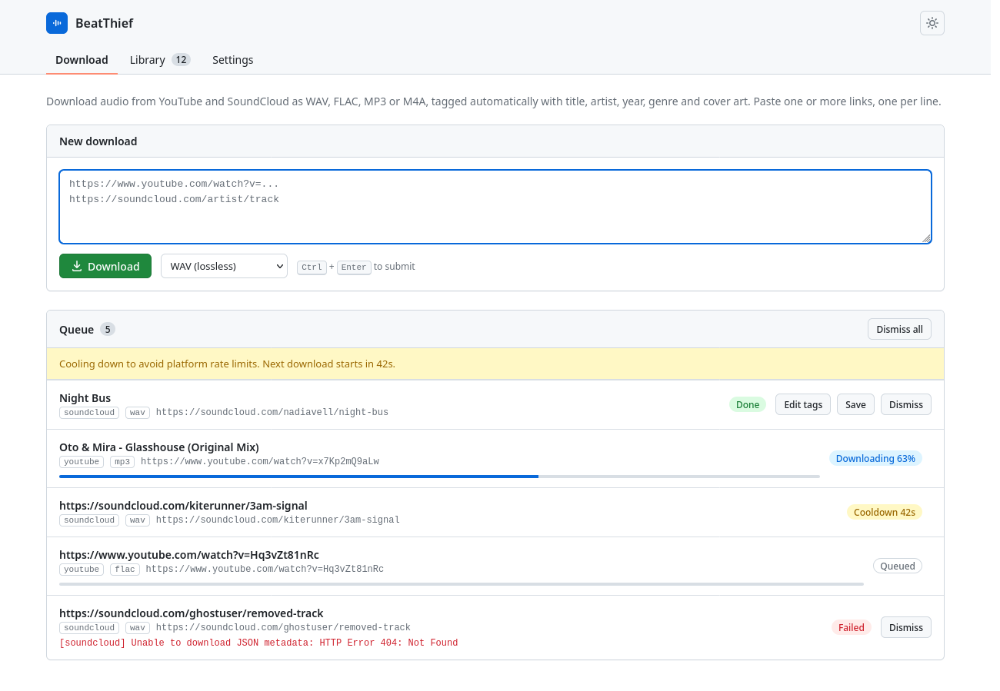
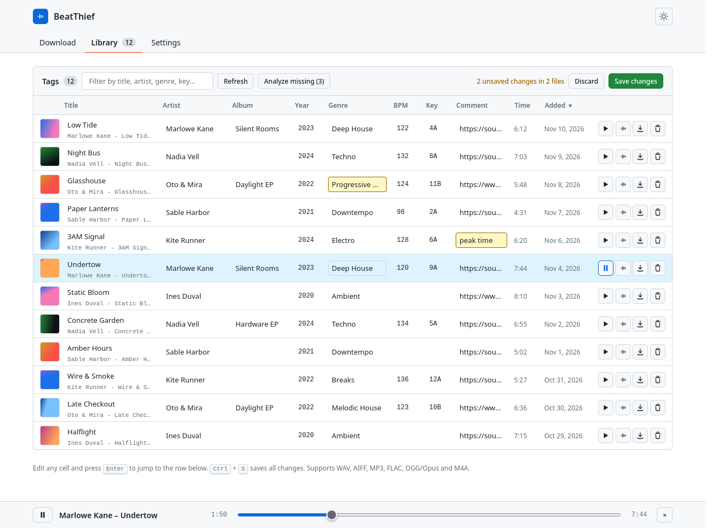
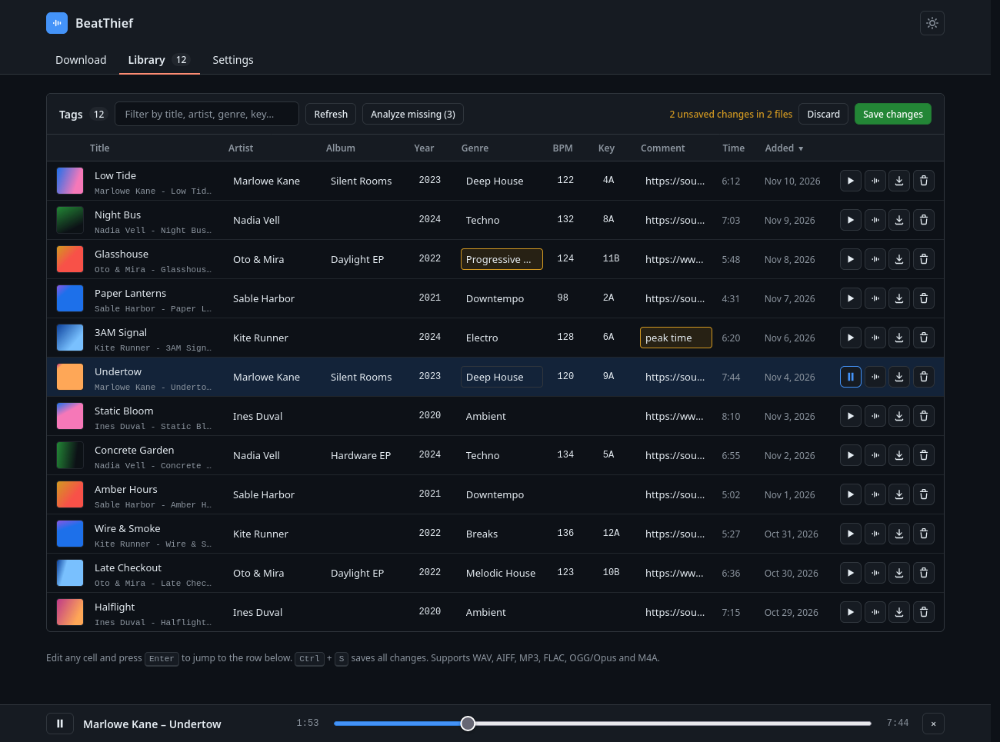
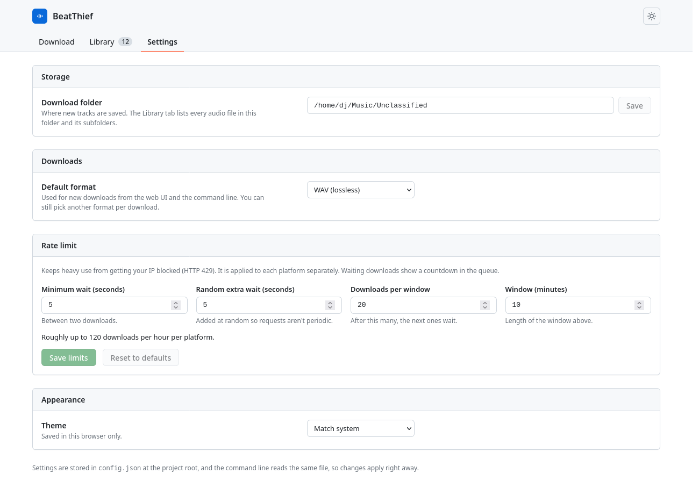

# BeatThief

BeatThief downloads audio from YouTube and SoundCloud, converts it to WAV (or FLAC, MP3, M4A), fills in the tags and gives you a small library to tidy everything up afterwards. It has a local web interface and a command line, both built on top of [yt-dlp](https://github.com/yt-dlp/yt-dlp).

It is aimed at building a music library: tracks land in one inbox folder, already tagged, and you clean them up and listen to them before they go anywhere else.



On the **Download** tab you paste one or more links, pick a format and hit Download. Each link becomes an entry in the queue with its progress. YouTube and SoundCloud each have their own rate limit, so if you throw a lot of links at it, the extra ones wait and the queue shows a countdown instead of getting your IP blocked.

## The library

Everything in the download folder (and its subfolders) shows up in the **Library** tab as an editable table. The tags are written when the file is downloaded, using whatever the platform gives us: title, artist, album, year, genre, cover art, and the source URL in the comment field. YouTube titles are messy, so `Artist - Title (Official Video) [HD]` gets cleaned up by a few rules; they're not perfect, which is why everything is editable.



Edit any cell and it turns yellow until you save. `Enter` jumps to the row below, `Ctrl+S` saves everything. The same table works with files you didn't download here: WAV, AIFF, MP3, FLAC, OGG/Opus and M4A are all supported.

A few other things live in that table:

- The play button on each row opens a small player at the bottom of the page, so you can check a track before keeping it. AIFF files won't play in Chrome or Firefox, only in Safari.
- The waveform button next to it detects the BPM and key of a track (in Camelot notation, like `8A`). **Analyze missing** does it for every visible row that has no BPM or key. The results are estimates and show up as unsaved changes, so you review them before they're written to the file. Expect the occasional double or half BPM.
- Files can be downloaded or deleted from there too.

There's a dark theme as well, which follows your system or can be set by hand.

<details>
<summary>Dark theme</summary>



</details>

## Settings

The download folder, default format, rate limits and theme all live in one place. The folder defaults to `~/Music/Unclassified`.



Settings are saved in `config.json` at the project root, and the command line reads the same file, so a change here applies right away without restarting anything.

## Installing

You need Python and FFmpeg. Python 3.10 or newer should be fine (I've only run it on 3.14). FFmpeg does the conversion to WAV and the others, and has to be on your `PATH`.

Everything Python-related goes into a virtual environment in the `.venv` folder, so nothing is installed system-wide, and deleting that folder is all it takes to remove it.

### Linux

Install Python and FFmpeg with your package manager:

```bash
sudo apt install python3 python3-venv ffmpeg    # Debian, Ubuntu
sudo dnf install python3 ffmpeg                 # Fedora
sudo pacman -S python ffmpeg                    # Arch
```

Then, from the project folder:

```bash
python3 -m venv .venv
source .venv/bin/activate
python -m pip install -r requirements.txt
```

### Windows

Install Python from [python.org](https://www.python.org/downloads/) (tick *Add python.exe to PATH* in the installer) and FFmpeg. The quickest way for FFmpeg is winget; open a new terminal afterwards so it picks up the `PATH`:

```powershell
winget install Gyan.FFmpeg
ffmpeg -version
```

Then, from the project folder in PowerShell:

```powershell
py -m venv .venv
.venv\Scripts\Activate.ps1
python -m pip install -r requirements.txt
```

If PowerShell refuses to run the activation script, run `Set-ExecutionPolicy -Scope CurrentUser RemoteSigned` once, or use `.venv\Scripts\activate.bat` from a regular Command Prompt. You can also skip activation entirely and call the venv's Python directly, like `.venv\Scripts\python -m beatthief web`.

BPM and key detection depends on [essentia](https://essentia.upf.edu/), which has no Windows build. `requirements.txt` skips it there, so everything else installs fine, and the analyze buttons will just tell you it isn't available.

## Running it

Run these from the project folder, with the venv activated (`source .venv/bin/activate` on Linux, `.venv\Scripts\Activate.ps1` on Windows) or by calling the Python inside `.venv` directly.

### Web interface

```bash
python -m beatthief web
```

Open <http://127.0.0.1:8000>. Use `--port` to change the port. By default it only listens on your own machine. `--host 0.0.0.0` makes it reachable from the rest of your network, but there is no login, so only do that on a network you trust.

### Command line

```bash
python -m beatthief download "https://soundcloud.com/some-artist/some-track" --format flac
python -m beatthief download "https://www.youtube.com/playlist?list=..." --playlist
```

The formats are `wav` (the default), `flac`, `mp3` and `m4a`.

## Good to know

- WAV, FLAC and the like are lossless containers, but YouTube and SoundCloud serve compressed audio. Converting to WAV doesn't bring back any quality, it just stores what was there without compressing it again. If sound quality matters, buy the track.
- The default rate limit is 20 downloads every 10 minutes per platform, with 5 to 10 seconds between them. That's on the cautious side, based on what's commonly recommended for yt-dlp, and you can change it in Settings.
- Downloading from these sites may go against their terms of use and, depending on the track, copyright law. Use it for things you're allowed to download.
